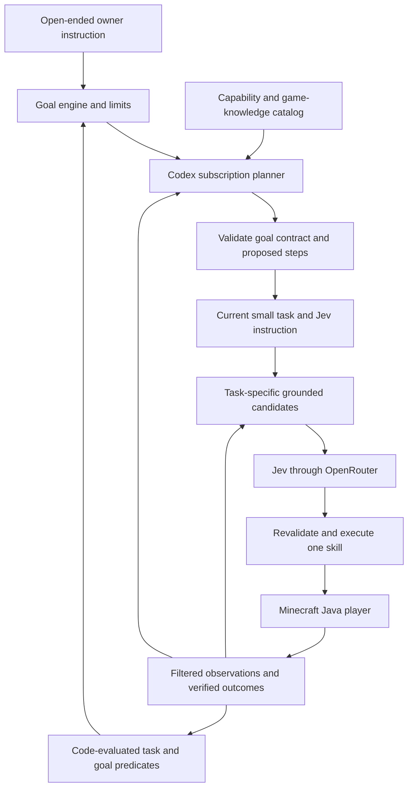

# V1 behavior and architecture

Plan: MB-V1. Created/updated: 2026-10-06. Owner: Codex. Status: **Implementation in progress; foundation, general skills and real Jev controller accepted locally; real subscription planning accepted; final V1 delivery remains outstanding.**

## User outcome

Jake can give Chunkbot broad Minecraft instructions in ordinary language. The gameplay LLM interprets the intended outcome, works out prerequisites, and breaks the goal into manageable steps. Jev chooses useful grounded actions for the current step. Application code controls the player and verifies what happened.

The command language remains open-ended. “Come here,” “collect stone,” “make yourself armor,” and other instructions are inputs to planning, not a fixed list of implemented goal handlers. Actual execution depends on available skills, observations, game mechanics, and world conditions. Missing capabilities produce a specific explanation or clarification; they do not silently change the goal.

## Confirmed Jake decisions

| Decision | Recorded choice |
| --- | --- |
| Edition/player interface | Java Edition; bot library; separate player with player-like visibility |
| Fast decisions | Jev first through OpenRouter |
| Gameplay planner | Jake's Codex subscription |
| Planning behavior | Broad instructions; LLM decides smaller steps and prerequisites |
| Development | Codex coordinates; local DSH Claude Code Opus 5.5 workers implement using Jake's Claude subscription |
| Current assignment | Implement the V1 plans under Codex supervision with local Opus 5.5/full-access workers; use a separate local test server first |

Jake clarified that earlier log/follow/armor examples must not become hardcoded goal restrictions. This clarification supersedes the original narrow demo scope.

## Coordinator assumptions and initial capabilities

Proposed stack: Node.js 24 LTS, strict TypeScript, npm, Mineflayer, and mineflayer-pathfinder. Pin compatible versions during the documented probes.

One owner, one bot, one active goal; local terminal and explicitly prefixed Minecraft chat. The planner is a separate bounded Codex process through supported subscription integration. DSH is the development runtime; Chunkbot does not require it to play after being built.

V1 establishes a general capability catalog covering:

- Bounded movement, looking/surveying, following observed targets, and exploration using reachable local waypoints.
- Mining observed blocks, item pickup, tool/equipment selection, and inventory inspection.
- Recipe-based crafting, workstation placement/use, and furnace/fuel/smelting interactions.
- Explicit block placement, item use, dropping/transferring items, and basic grounded entity interactions, including direct attacks where the installed adapter supports them.
- Read-only game-knowledge queries for version-correct items, recipes, tools, harvest requirements, and current observed affordances.

Each capability declares inputs, preconditions, candidate generation, execution, observable outcomes, cancellation, and limitations. The planner learns this catalog. User goal composition lives in the planner rather than custom “collect stone” or “make armor” application handlers.

These are initial player mechanisms, not a guarantee of every Minecraft mechanic. Specialized interfaces or unsupported mechanics must be identified through capability evidence. A new goal using existing primitives must work without code changes; a genuinely new mechanic may need a new capability.

Observation policy is nearby line-of-sight awareness with remembered observations labeled separately. It is not an exact camera/screenshot simulation. Pathfinder may use loaded collision geometry internally without exposing hidden world data to models.

## Example happy path: collect stone from an empty inventory

This is a test case, not a prescribed plan template.

1. Jake gives the goal. Chunkbot acknowledges its interpreted outcome and any necessary clarification.
2. Codex examines the skill catalog, observed world, inventory, and queried recipes/harvest requirements.
3. It may decide to obtain wood, craft planks/sticks and a workbench, craft/equip a suitable pickaxe, locate reachable stone, mine it, and satisfy the requested output.
4. Each step carries an objective, permitted skill/target policy, Jev instruction, and code-evaluable completion conditions.
5. Jev chooses actual actions from current grounded candidates. New observations and skill results feed back into the task and planner.
6. Code verifies the accepted goal outcome and releases control. A changed world or missing prerequisite triggers a revised plan without abandoning the original goal.

Stone and cobblestone are distinct items. The planner must use game mechanics and clarify or explain its interpretation rather than assert that mining normal stone yields stone items. For exact stone items, a valid plan may require smelting or another suitable supported mechanism.

## Data flow

The planner may create a short plan, request bounded information, ask Jake a meaningful clarification, or explain an actual missing capability. It extends/revises the plan as evidence changes. Jev handles immediate choices, while skills handle movement/interaction timing and code checks completion.

Generating a Jev “script” means producing structured steps and bounded decision instructions. Runtime-generated JavaScript is not required for open-ended goals; new executable skills are separate validated development work.

## Commands and interaction

Minecraft: `!chunkbot <natural-language instruction>`. `!chunkbot goal <instruction>` is an optional explicit alias. Reserve `!chunkbot stop`, `!chunkbot status`, and `!chunkbot answer <reply>` for control and pending clarification. Terminal uses the same language/control verbs without the prefix. “Follow me” passes through the same planner as other goals.

Only the configured owner may issue chat instructions. Use verified UUID identity online; exact names are acceptable only in an explicitly trusted loopback offline fixture. Ordinary chat and observed world text are data, not instructions.

Validate empty/oversized input before replacing work. A valid new goal cancels the previous goal before planning. Planning and pending clarification cause no game actions. Status causes no inference. Stop works during joining, planning, clarification, navigation, mining, crafting, and waiting.

A clarification preserves the goal and verified progress. Replies are correlated to the pending question. A material interpretation must be shown to Jake; do not silently turn an armor request into a resource-only goal.

## Completion, failure, and persistence

The planner proposes explicit desired outcomes using the shared predicate vocabulary. Code validates their form, references, capabilities, and consistency, and evaluates game evidence. Intermediate steps may finish while the full goal remains unmet. Neither a “done” message nor exhaustion of one planning window completes a goal.

Quantities distinguish collecting additional items, currently possessing items, and consuming ingredients. Returning to a remembered owner location does not prove the owner is present. A persistent “follow me” goal remains active until stopped or blocked.

Block changes, missing tools, unreachable targets, unavailable resources, and surprises produce bounded local recovery or a planner replan. Do not skip a required outcome, invent target coordinates, claim item transfer without observable evidence, or fall back to hidden player positions.

Death, disconnect, dimension change, low-health guard, exhausted limits, or failed cleanup ends active control with its actual reason. Restart/rejoin/respawn starts idle; goals do not auto-resume. World/inventory changes persist normally, and stop does not roll them back.

Persist configuration and redacted run evidence, not active goals or long-term memory. Auth caches/keys remain outside checked-in files.

## Provisional limits

Coordinator defaults, adjustable through validated configuration after evidence:

| Setting | Initial default |
| --- | --- |
| Local model-visible observation radius | 32 blocks |
| Goal travel/exploration radius from starting anchor | 128 blocks |
| Near-owner distance | 3 blocks |
| Proposed planning window / total task ceiling | At most 8 steps / 64 admitted steps |
| Jev options / concurrent requests | At most 8 options / one in flight |
| Jev minimum interval / request timeout | 1 second / 5 seconds |
| Planner request timeout / turns per goal | 45 seconds / at most 20, including information requests, retries, and replans |
| Goal deadline / Jev requests per goal | 20 minutes / at most 1,200 including retries |
| No-progress window / owner-loss window when owner is required | 30 seconds / 10 seconds |
| Per-target retries / replans | At most 2 / at most 8 within total turn limit |
| Low-health interruption | Health at or below 8 of 20 |
| OpenRouter estimated spend cap per app run | $1, using conservative reservations |

Deadlines bound work; they do not restrict the instruction language to fixed goals. A larger assignment that cannot finish within limits must report partial progress and remaining work.

No-progress applies to attempts at unmet outcomes. Planning uses its own timeout. Intentional waiting near the owner, waiting on verified furnace processing, and pending clarification are not stalls. Stable waiting makes no repeated inference calls; local events and guard timers drive reevaluation. Overall deadlines remain in force.

Dollar accounting is a local estimate, not a provider-enforced billing guarantee. Ambiguous-charge timeouts retain reservations. Codex usage is turns/tokens and subscription-limit evidence, not invented API charges. No automatic paid fallback or credit purchase.

## Acceptance and remaining dependencies

V1 acceptance must include differing goals and a previously untemplated combination of existing skills. The full matrix is in [integration acceptance](v1-integration-plan.md); boundaries are in [contracts](v1-contracts.md); dated facts and capability probes are in [research](v1-research.md).

Local DSH, the separate vanilla26.1.2 fixture, general skills, Jev wire/account/price and Codex isolation transport probes are verified. The task-driven Jev controller, real gameplay planner and integrated autonomous acceptance remain outstanding. Eventual shared-server/version and bot Microsoft-account details are unconfirmed. Voice, multiple companions, Bedrock, a web dashboard, and long-term memory are separate work. Crafting and armor are no longer blanket scope exclusions.
